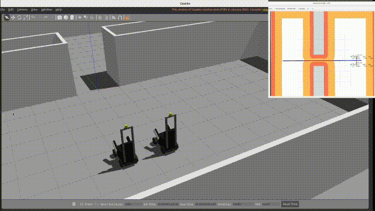
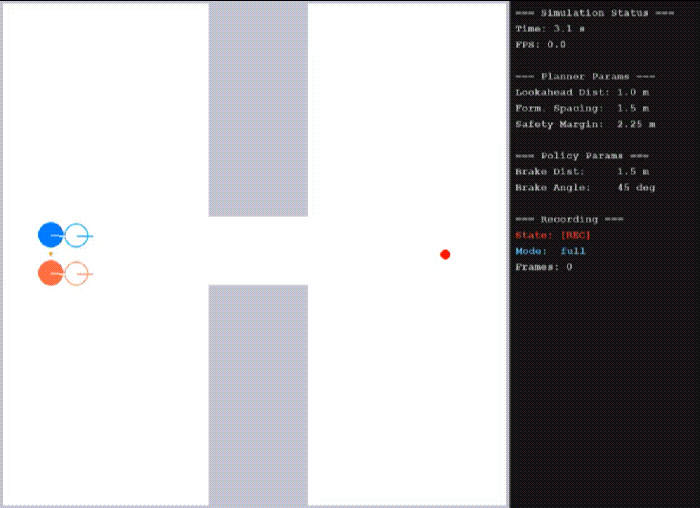
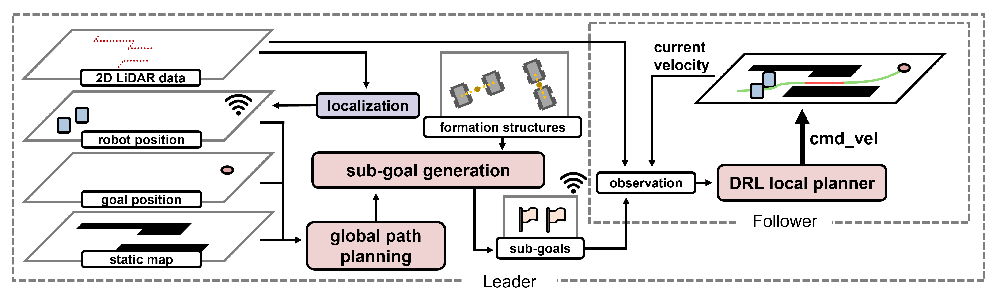
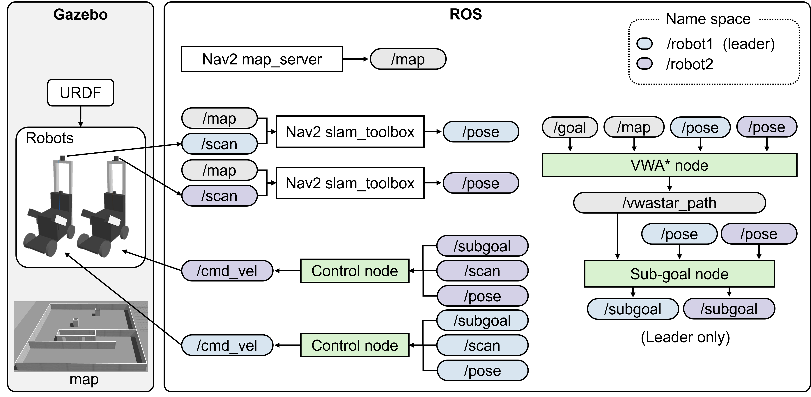

# 複数のパーソナルモビリティの隊列協調ナビゲーション

複数台の WHILL（パーソナルモビリティ）が、周囲の空間に合わせて隊形を変えながら共通のゴールへ自律移動するマルチロボットナビゲーションシステムです。広い場所では横並び、狭い通路では一列になって進みます。



*Gazebo / ROS 2：2台の WHILL が隊形を切り替えて狭い通路を通過している様子（右上は RVizでコストマップ、経路、サブゴールが表示されている）。*



*2Dシミュレータ：提案手法を pygame 上で実行した様子（右側は情報パネル）。*

## 概要

隊形の決定はチーム全体で行い、障害物の回避は各ロボットが個別に行います。この役割分担を、次の3つの要素で実現しています。

1. **大域経路計画（VWA\*）**
   リーダーが、チーム全体を1台の大きなロボットとみなして経路を計画します。隊形ごとにマージン幅を設定しておき、通路の幅に応じて経路上の各区間の隊形（横並び / 縦列）を決めます。計画した経路には、区間ごとの隊形の情報が含まれます。
2. **サブゴール生成・割り当て**
   経路上の隊形の情報をもとに、チームの進行方向に沿って各ロボットのサブゴールを生成します。生成したサブゴールは、ハンガリアン法によって移動距離が最小になるようにロボットへ割り当てます。
3. **局所経路計画（DDPG）**
   各ロボットは、強化学習（DDPG）で学習した方策によって、自分のサブゴールへ向かいます。方策の入力は LiDAR、サブゴールの情報、自分の速度です。


## システム構成





| 要素 | 実装 |
|---|---|
| 大域経路計画（VWA\*） | `multi_robot/navigation/vwastar_planner.py`（2Dシミュレータ）、`ros2_ws/src/ros2_vwastar`（ROS 2） |
| サブゴール生成・割り当て | `multi_robot/navigation/vwastar_planner.py` の `TeamNavigationController`、`multi_robot/navigation/formation_sidebyside_5.py` |
| 局所経路計画（DDPG） | `rl_training/`（学習）、`multi_robot/navigation/policy2_newobs.py`（推論） |
| 2Dシミュレータ | `multi_robot/navigation/simulator_v5_multi.py`、`simulation_core/` |
| ROS 2 ノード | `ros2_ws/src/coordinated_navigation/src/node_2.py` |


## リポジトリ構成

```
coordinated_navigation_system/
├── multi_robot/
│   ├── navigation/        # 提案手法：シミュレータ、VWA*、サブゴール生成、方策
│   │   └── baseline/      # 比較手法（先行研究）
│   ├── experiments/       # 評価実験のスクリプト
│   ├── config/            # 経路計画 / 方策 / 比較手法のパラメータ
│   ├── maps/              # 画像マップ
│   └── models/            # 学習済みの方策
├── rl_training/           # DDPG の学習：Gym 環境、ネットワーク、コールバック、設定
├── simulation_core/       # 2Dシミュレータ：環境、LiDAR、マップ生成
├── ros2_ws/src/
│   ├── coordinated_navigation/             # 提案手法のROS2ノード
│   ├── coordinated_navigation_interfaces/  # Formation メッセージ
│   ├── ros2_vwastar/                       # VWA* 経路計画
│   ├── maps/                               # 地図
│   └── ros2_whill, ros2_whill_interfaces   # WHILL のドライバ
├── results/               # 実験結果の CSV と動画
└── archive/               # 開発時のコード
```

## 動作環境

- Ubuntu 22.04
- Python 3.10
- uv
- ROS 2 Humble、Gazebo Classic

## インストール

```bash
git clone --recursive https://github.com/KeitoTsubaki/coordinated_navigation_system.git
cd coordinated_navigation_system

uv sync
```


ROS 2 ワークスペース：

```bash
source /opt/ros/humble/setup.bash
cd ros2_ws
colcon build
source install/setup.bash
```

## 使い方


### 2Dシミュレータ
```bash
uv run python -m multi_robot.navigation.simulator_v5_multi --robots 2 --map-type random
```

主なオプション：`--robots`、`--formation-type`、`--formation-spacing`、`--map-type {trap_shaped,zigzag,random,empty,image}`、`--image-map-path`、`--fps`、`--config`

| キー | 操作 |
|---|---|
| `M` | 学習済み方策による走行の開始 / 停止（開始と同時に録画も始まる） |
| `SPACE` | 新しいマップを生成 |
| `R` | 今のマップで最初からやり直す |
| `C` | マップの種類を切り替え |
| `F` | 隊形に従う / 従わない（OFF にすると各ロボットが自分のゴールへ直接向かう） |
| `V` | 隊形探索の直交制約の ON / OFF |
| `TAB` / `1`〜`9` | 操作・表示の対象にするロボットを選択 |
| `W` / `Q` / `E` | 方策が停止しているときに、選択中のロボットを手動で前進 / 左旋回 / 右旋回 |
| `L` / `P` / `D` | LiDAR / 軌跡 / デバッグ表示の切り替え |
| `ESC` | 終了 |

### 実験で使ったマップで実行する

評価実験で使ったマップは `multi_robot/maps/` に入っています。

| マップ | ファイル | 内容 |
|---|---|---|
| straight | `straight.jpg` | 中央に狭い通路が1本ある直線のコース |
| curve | `curve.png` | 斜めに曲がる狭い通路を通るコース |
| shortcut | `shortcut.png` | 狭い近道と、広い回り道があるコース |

`--map-type image` と `--image-map-path` でマップの画像を指定します。

```bash
uv run python -m multi_robot.navigation.simulator_v5_multi --robots 2 --map-type image --image-map-path multi_robot/maps/straight.jpg
```

スタート位置とゴール位置は `multi_robot/config/planner_params.yaml` の `start_pos_m` と `goal_pos_m` で指定します。

### 学習

```bash
uv run python -m rl_training.train_v4 --total-timesteps 10000000
```


### ROS 2 / Gazebo

```bash
ros2 launch coordinated_navigation gazebo_policy_multi_vwastar.launch.py
```

